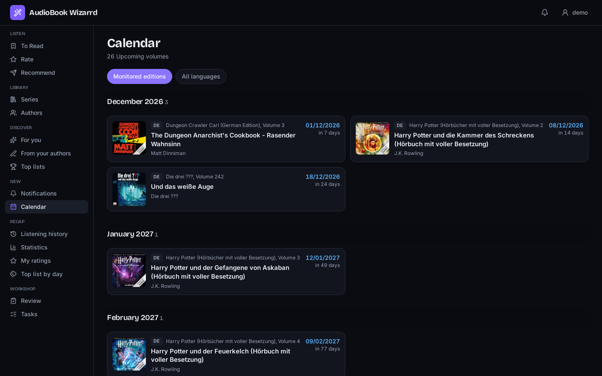
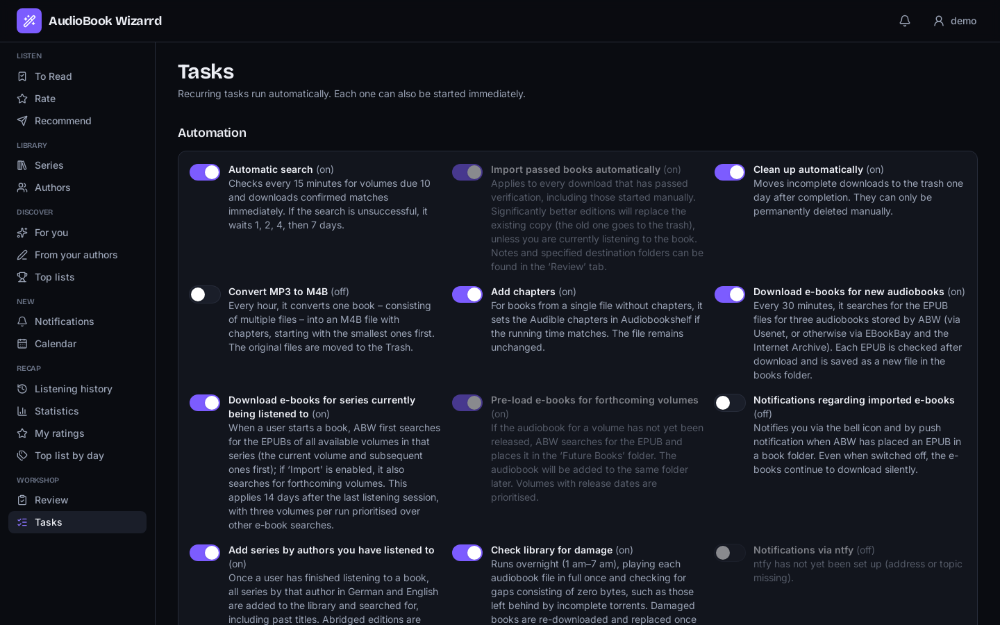
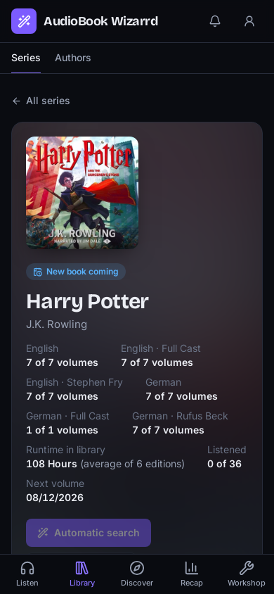
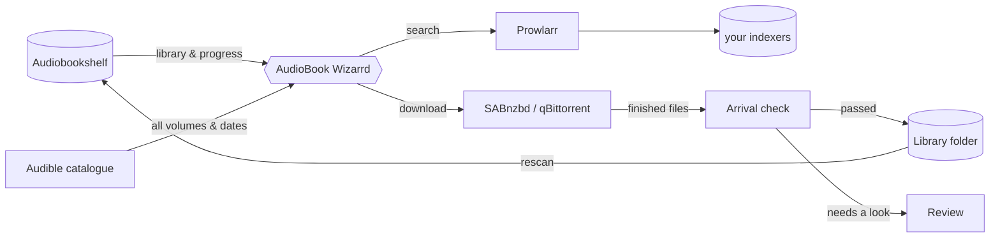

<div align="center">

# 🪄 AudioBook Wizarrd

**Your audiobook series, complete.**
A self-hosted companion for [Audiobookshelf](https://www.audiobookshelf.org/) – think *Sonarr, but for audiobook series*.

[](https://github.com/moritzfrey95-beep/audiobook-wizarrd/actions/workflows/ci.yml)
[](LICENSE)


[Features](#-features) · [Screenshots](#-screenshots) · [Quick start](#-quick-start) · [Configuration](#%EF%B8%8F-configuration) · [How it works](#-how-it-works) · [FAQ](#-faq) · [Deutsch](#-deutsch)


</div>

---

## 👋 What is this?

You love long audiobook series. Audiobookshelf plays them beautifully – but it does not tell you that volume 7 came out last
week, that the German edition is missing two books, or that a new volume is announced for March.

**AudioBook Wizarrd (ABW)** looks at every series in your library, compares it with everything Audible knows about that series,
and shows you at a glance what is complete, what is missing and what is coming. If you want, it goes one step further: it searches
your own indexers through Prowlarr, downloads with SABnzbd or qBittorrent, **checks every download** (runtime, tags, a spoken
intro) and files it neatly into your library – then tells Audiobookshelf to rescan.

Everything runs on your own server. ABW talks only to services you run yourself and to the public Audible catalogue.

> **Status:** early (0.x). ABW is used every day on one home server with a library of several thousand audiobooks.
> Expect rough edges, and please [open an issue](../../issues) when you find one.

---

## ✨ Features

### 📚 Library overview
- **Every series with all its volumes** from the public Audible catalogue (audible.com and audible.de), with covers, release dates and runtimes
- **Status at a glance:** complete, incomplete, new book coming, actively searching, downloading, in review
- **English and German editions** of the same series on one card – plus alternative recordings (full cast, other narrators)
- **Standalone books** grouped per author, **omnibus editions** recognised and split into volumes
- Filters by language, status, genre and tag; sort by name, recently added, missing volumes, next release, length

### 🔎 Search & download
- Search via **[Prowlarr](https://prowlarr.com/)** across your Usenet and torrent indexers
- Download via **SABnzbd** (or anything with its API) and **qBittorrent**, each into its own folder
- **Scoring with reasons:** every result is rated *sure*, *possible* or *rejected* – and ABW tells you why
- **Guided search** for manual control, **automatic search** for the boring part (with back-off: 1, 2, 4, 7 days)
- Optional **e-books** (EPUB) for your audiobooks, placed next to them for Audiobookshelf's e-reader

### ✅ Arrival check & import
- Every download is **checked before it touches your library:** runtime vs. Audible, tags, file integrity, narrator
- Optional **speech recognition** of the first minute (faster-whisper): is it really *this* book, in *this* language?
- **Import** into the right library folder (`Series/Book X - Title`, next to the volumes you already have), with metadata for Audiobookshelf
- **Better editions replace worse ones** automatically (old files go to a trash folder, never deleted directly)
- Optional **MP3 → M4B** conversion with chapters, **chapters from Audible**, nightly **integrity scan** for broken files

### 👥 For the whole household
- **Multiple users** – or simply sign in with your Audiobookshelf account
- Personal **To Read** lists, **ratings**, **recommendations** ("For you", "From your authors", top lists)
- Requests from users are highlighted and tagged in Audiobookshelf (*requested by …*)
- **Listening history & statistics**, a release **calendar**, **notifications** in the app, via browser push or [ntfy](https://ntfy.sh)
- Installable as an **app** (PWA), works great on the phone

### 🧰 Built for self-hosters
- **One Docker image**, SQLite, no external database
- **Setup wizard** on first start, every connection testable in the UI
- **English and German** interface (per user, follows your browser)
- **Extensions:** add your own sources as plugins without forking ([details](#-extensions))
- Automation is **off by default** – nothing is downloaded or moved until you switch it on

---

## 📸 Screenshots

| Series detail | Release calendar |
|---|---|
|  |  |
| **Statistics** | **Tasks & automation** |
|  |  |

<p align="center"><br><sub>On the phone</sub></p>

---

## 🚀 Quick start

**You need:** Docker with Compose, a running Audiobookshelf with at least one *book* library, and an API key from
Audiobookshelf (*Settings → API Keys*). Prowlarr, SABnzbd and qBittorrent are optional.

```sh
git clone https://github.com/moritzfrey95-beep/audiobook-wizarrd.git
cd audiobook-wizarrd
cp .env.example .env
nano .env                      # at least MUSIC_ROOT_HOST and the folder names
docker compose up -d --build
```

Open **`http://<your-server>:8790`** and follow the setup wizard:

1. **Account** – create an admin (or skip: then ABW is only reachable from your home network)
2. **Audiobookshelf** – address, API key, pick your English and/or German library *(required)*
3. **Prowlarr** – test the connection, tick the indexers ABW may use
4. **SABnzbd / qBittorrent** – download clients and their finished-download folders
5. **Notifications** and **extras** – all optional

After the wizard ABW reads your library and asks Audible about every series. The first run takes a few minutes for a large
library. **All automation stays off** until you enable it under *Workshop → Tasks*.

> 💡 **Folders are always entered as ABW sees them inside the container.** Mount your library and download folders in
> `.env` / `compose.yaml` first; the wizard checks that each folder exists and is writable.

### Speech recognition (optional)

The intro check uses [faster-whisper](https://github.com/SYSTRAN/faster-whisper) and makes the image considerably larger, so it is
off by default. Set `ABW_WHISPER=1` in `.env` and rebuild. Without it, the check simply skips the spoken intro.

---

## ⚙️ Configuration

There are two layers:

1. **`.env`** – everything Docker needs to know: folders to mount, user/group, ports, image variant.
2. **Settings → Connections** in the UI – URLs, API keys, libraries, indexers. Values saved here are stored in the database
   and **take precedence** over `.env`, so you can configure everything in the browser.

### Folders

| Variable | Mounted at | What it is |
|---|---|---|
| `ABW_DATA` | `/data` | Database, keys, caches. **Back this up.** |
| `MUSIC_ROOT_HOST` | `/library-root` | Folder containing your library folders (`LIBRARY_EN_DIR`, `LIBRARY_DE_DIR`) and the trash |
| `USENET_COMPLETE_HOST` | `/usenet-complete` | SABnzbd's finished folder for ABW's category |
| `TORRENT_COMPLETE_HOST` | `/torrent-complete` | qBittorrent's save folder for ABW (`QBIT_SAVE_ROOT` is the same folder as qBittorrent sees it) |
| `WHISPER_MODELS_HOST` | `/models/whisper` | Optional cache for the speech model |
| `ABW_PLUGINS_HOST` | `/plugins` | Optional extensions |

ABW runs as `ABW_UID:ABW_GID` (default `1000:1000`) – make sure that user may read the download folders and write to the library.

### Services

| Service | Required | Used for | Configure |
|---|---|---|---|
| **Audiobookshelf** | ✅ | library, users, progress, import target | wizard / `ABS_*` |
| **Prowlarr** | for searching | Usenet and torrent indexers | wizard / `PROWLARR_*`, `*_INDEXER_IDS` |
| **SABnzbd** | optional | Usenet downloads | wizard / `SABNZBD_*` |
| **qBittorrent** | optional | torrent downloads | wizard / `QBIT_*` |
| **ntfy** | optional | push notifications (browser push works without) | wizard / `NTFY_*` |
| **FlareSolverr** | optional | Goodreads genres, some extensions | wizard / `FLARESOLVERR_URL` |

Secrets can be passed as files (`*_HOST_FILE` in `.env`, mounted read-only) or entered in the UI.
They are never sent back to the browser.

### Running next to other containers

If Prowlarr, SABnzbd & co. live in other Compose projects, add their networks in a `compose.override.yaml` next to
`compose.yaml` (it is ignored by git and loaded automatically):

```yaml
services:
  abw:
    networks: [default, media]
networks:
  media:
    name: my-media-network
    external: true
```

---

## 🧭 How it works



1. **Sync** – ABW reads your libraries from Audiobookshelf and asks Audible for every series (respecting a polite request rate).
2. **Gap detection** – volumes Audible knows but your library lacks become *missing*; future ones become *upcoming*.
3. **Search** – for missing volumes ABW queries Prowlarr with several query variants and scores each result
   (title, volume number, author, narrator, language, size, omnibus detection).
4. **Download** – sure results start automatically (if enabled), unsure ones wait under *Review → Select a result*.
5. **Arrival check** – runtime, tags, file integrity and optionally the spoken intro are compared with Audible.
6. **Import** – passed downloads are moved into the library, Audiobookshelf is told to rescan, and the download folder is cleaned up.

Every automatic step can be switched on and off individually, and each series can opt out.

---

## 🧩 Extensions

Usenet and torrent search go through Prowlarr. If you have a source Prowlarr cannot handle, write a small plugin instead of
forking ABW. Put a Python module in the folder mounted at `/plugins`:

```python
# /plugins/my_source.py
from pathlib import Path

class MySource:
    key, name, order = "mysource", "My source", 5
    root = Path("/my-downloads")          # finished downloads as ABW sees them

    def configured(self): return True
    def search(self, queries):            # -> (results, errors)
        return [{"guid": "…", "source": self.key, "title": "Author - Title", "size": 300_000_000}], []
    def refresh(self, guid): ...
    def submit(self, guid, marker): ...    # start download into root/marker, return client id
    def status(self, rows): ...            # {download_id: {"state": "downloading", "progress": 0.4}}
    def can_start(self): return True

def register(abw):
    abw.add_source(MySource())
```

The full interface is documented in [`backend/abw/plugins.py`](backend/abw/plugins.py). Extra Python packages can be installed
at build time with `ABW_EXTRA_PIP`.

---

## ❓ FAQ

<details>
<summary><b>Does ABW change my existing audiobooks?</b></summary>

Only if you switch on import (`ABW_IMPORT_ENABLED=1`) and the related tasks. Replaced files go to a trash folder on the same
disk; nothing is deleted without you pressing a button. Without import, ABW is read-only towards your library.
</details>

<details>
<summary><b>Which languages and Audible regions are supported?</b></summary>

English (audible.com) and German (audible.de) libraries – one Audiobookshelf library per language, each optional.
The interface is available in English and German. More regions are possible; open an issue if you need one.
</details>

<details>
<summary><b>Do I need Usenet or torrents?</b></summary>

No. Without Prowlarr ABW is a very good overview of your series: what is complete, what is missing, what is coming.
</details>

<details>
<summary><b>Can my family use it?</b></summary>

Yes. Create users in *Settings*, or import them from Audiobookshelf so they sign in with their existing password.
Users can browse, rate, keep a To Read list and request books; reviewing and tasks stay with admins.
</details>

<details>
<summary><b>Can I expose ABW to the internet?</b></summary>

Only behind a reverse proxy with HTTPS and with sign-in enabled. Without an account ABW refuses requests from outside your network.
</details>

<details>
<summary><b>Where are my settings stored? How do I back up?</b></summary>

Everything lives in `ABW_DATA` (SQLite database `abw.db` plus keys). Back up that folder; `scripts/nightly_backup.py`
shows one way to do it (consistent SQLite backup with rotation).
</details>

---

## 🛠️ Development

```sh
# backend
cd backend
python -m venv .venv && .venv/bin/pip install -r requirements.txt -r requirements-dev.txt
.venv/bin/python -m pytest -q
ABW_DATA_DIR=./data .venv/bin/python -m uvicorn abw.api:app --port 8790

# frontend (proxy to :8790)
cd frontend && npm ci && npm run dev
```

Stack: **FastAPI** + **SQLite** (backend), **React 19**, **Vite**, **Tailwind 4**, **TypeScript** (frontend), one Docker image with ffmpeg.

**Translations:** the code is written in German; English lives in `frontend/src/locales/en.json` and
`backend/abw/locales/en.json`. See [`scripts/i18n/README.md`](scripts/i18n/README.md) for how to add or update translations.

**Contributing:** issues and pull requests are welcome. Please keep pull requests focused, add tests for behaviour changes,
and run `pytest`, `npm run build` and `npm run lint` before pushing – CI does the same.

---

## ⚖️ Legal

AudioBook Wizarrd does not host, index or distribute any content. It is a management tool that talks to software you run
yourself. You are responsible for complying with the laws of your country and the terms of the services you use.
Only download audiobooks you are entitled to. ABW is not affiliated with Audible, Amazon or Audiobookshelf.

## 📄 License

[GPL-3.0](LICENSE) – free to use, change and share, as long as derived works stay open too.

---

## 🇩🇪 Deutsch

**AudioBook Wizarrd** ergänzt [Audiobookshelf](https://www.audiobookshelf.org/), ähnlich wie Sonarr für Serien.
Es zeigt jede Hörbuch-Serie mit allen Bänden laut Audible, erkennt fehlende und angekündigte Bände, sucht sie auf Wunsch über
Prowlarr, lädt mit SABnzbd oder qBittorrent, **prüft jeden Download** (Laufzeit, Tags, gesprochene Ansage) und legt ihn sauber in
die Bibliothek.

**Das kann ABW**
- Serienübersicht mit Cover und Status, deutsche und englische Fassung auf einer Karte, andere Sprecher und Hörspiele
- Suche über Prowlarr, Download über SABnzbd und qBittorrent, Bewertung jedes Treffers mit Begründung
- Ankunftsprüfung vor der Ablage, bessere Fassungen ersetzen schlechtere, Papierkorb statt Löschen
- Mehrere Benutzer (auch mit dem Audiobookshelf-Konto), To-Read-Listen, Bewertungen, Empfehlungen, Kalender, Statistik
- Push-Meldungen, als App installierbar, Oberfläche auf Deutsch und Englisch
- Setup-Wizard, alle Verbindungen in der Oberfläche einstell- und prüfbar, Erweiterungen für eigene Quellen

**Schnellstart**

```sh
git clone https://github.com/moritzfrey95-beep/audiobook-wizarrd.git
cd audiobook-wizarrd && cp .env.example .env   # Ordner eintragen
docker compose up -d --build
```

Dann `http://<server>:8790` öffnen. Der Setup-Wizard fragt nach Audiobookshelf (Pflicht), alles andere ist optional.
Nach der Einrichtung ist die **Automatik aus**, bis du sie unter *Werkstatt → Aufgaben* einschaltest.
Ordner gibst du so an, wie ABW sie im Container sieht. Spracherkennung (Whisper) gibt es mit `ABW_WHISPER=1`.

ABW stellt keine Inhalte bereit und spricht nur mit Diensten, die du selbst betreibst. Lade nur Hörbücher, die du laden darfst.
Lizenz: GPL-3.0.
